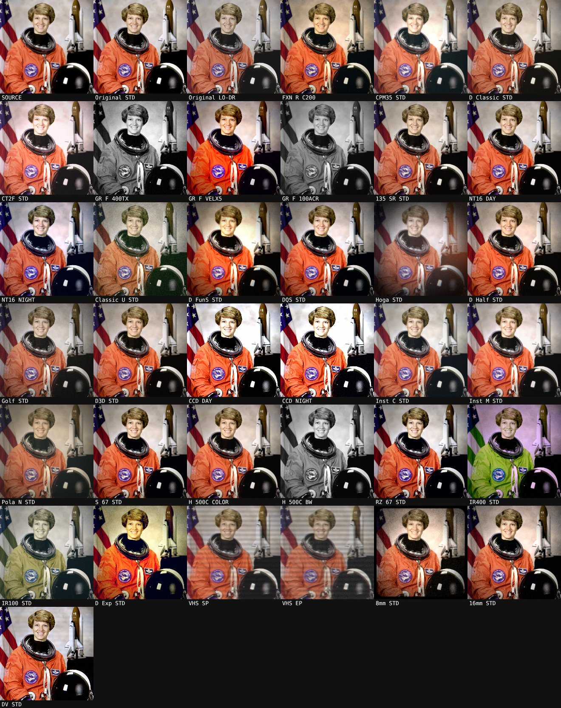

# DazzDroid

A retro film & camcorder camera for Android, inspired by the classic analog/CCD camera apps.
Every camera is a real-time GPU "film engine" preset: the same shader drives the live
viewfinder, video recording, still processing and imported photos/videos, so what you see is
what you get.



## Cameras

| Format | Cameras |
| --- | --- |
| 35mm | **FXN R** (Fujicolor everyday), **CPM35** (pastel compact), **D Classic** (amber rangefinder), **CT2F** (flash paparazzi compact), **GR F** (400TX / VELX5 / 100ACR stocks), **135 SR**, **NT16** (Day / tungsten Night), **Classic U** (expired SLR film) |
| Disposable / toy | **D FunS**, **DQS**, **Hoga** (light leaks, heavy vignette), **D Half** (two half-frames stitched), **Golf** (4-lens motion grid), **D3D** (4-angle wiggle loop, saved as MP4) |
| Digital | **Original** (STD / LO-DR, pairs with RAW), **CCD** (Day / Night) |
| Instant | **Inst C** (square card), **Inst M** (mini card), **Pola N** (thick-bottom frame) |
| Medium format | **S 67**, **H 500C** (Color / BW), **RZ 67** |
| Specialty | **IR400**, **IR100** (false-color infrared), **D Exp** (cross-processed) |
| Video | **VHS** (SP / EP), **8mm**, **16mm**, **DV** |

All non-composite cameras also work in video mode and on imported media.

## Features

- **Live filtered viewfinder** (OpenGL ES 2) with grain, halation, bloom, chromatic aberration,
  light leaks, vignette, split toning, channel mixing (infrared), tape wobble / chroma bleed /
  scan lines (VHS), gate weave / dust / scratches / flicker (8mm & 16mm), sharpening & sensor noise (CCD/DV).
- **Video recording** with the filter baked in (H.264 + AAC), including VCR / DV date overlays.
- **RAW**: Settings → *Save RAW (DNG)* stores the unprocessed sensor DNG next to the filtered JPEG
  (on devices whose Camera2 HAL exposes RAW).
- **Manual controls**: exposure compensation, white balance (Kelvin) and tint, ISO and shutter
  speed (on devices with manual-sensor support), filter intensity.
- **Lens attachments**: fisheye, prism, starburst, ND.
- **Double exposure**, **self timer** (3s / 10s), **flash** (torch on rear, screen flash on front),
  **grid**, **level**, tap-to-focus, pinch zoom, volume-key shutter.
- **Date stamps**: orange 7-segment LED, digital, VCR and DV styles with an editable date.
- **Aspect ratios** 1:1, 4:5, 3:4, 2:3, 9:16 plus film borders (35mm sprockets, 120 rebates) and
  instant-film cards.
- **Import** photos or videos from the gallery and develop them with any camera.
- Saves to `Pictures/DazzDroid` and `Movies/DazzDroid`.

## Building

Requires JDK 17+ and the Android SDK (platform 35).

```bash
./gradlew assembleDebug
```

The APK is written to `app/build/outputs/apk/debug/app-debug.apk`. GitHub Actions also builds
debug and release APKs on every push (see the *Build APK* workflow artifacts).

## Tuning cameras

Camera presets live in [`app/src/main/assets/cameras.json`](app/src/main/assets/cameras.json) and
the film engine in [`app/src/main/assets/shaders/filter.frag`](app/src/main/assets/shaders/filter.frag).
Each `spec` key maps to a shader uniform (`grain` → `uGrain`). `mix` is a row-major 3x3 color
matrix; `black`/`white` set per-channel output levels (fade); `shadowTint`/`highTint` split-tone.

## Notes

- Camera names are descriptive nicknames for the film/camera styles they emulate; no
  third-party assets are included.
- minSdk 26 (Android 8.0), target SDK 35.
